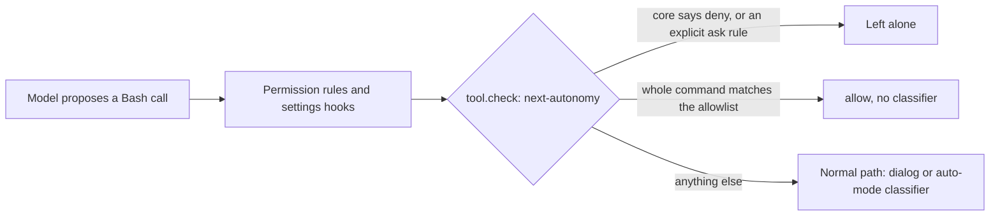
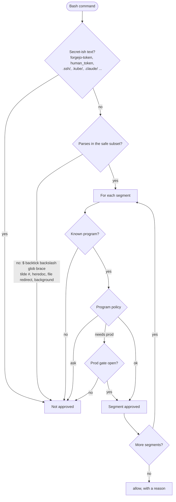
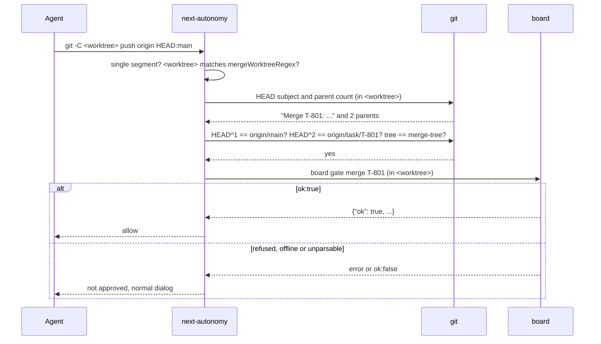
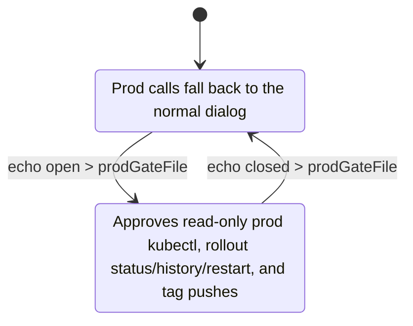

# next-autonomy

A Claude Code mod for `/next`-driven devops. It lets an agent do the routine work (dev `kubectl`, `git`, `tea`,
`board`, and a merge to `main`) without a permission prompt per step, while keeping two things mechanical:
the board's merge gate and a switchable prod gate. It does not replace review or the board. It makes the gate
something a command has to pass instead of something an agent promises.

It belongs to the `next` skill and the board, not to one project. Everything project-specific is a setting.

## How it works in one paragraph

The mod handles the engine event `tool.check`, which Claude Code raises before a tool call is decided. For a Bash
call it returns `allow` when the whole command matches the allowlist, and otherwise returns the engine's own
answer unchanged. It never returns `deny`, and it never overrides a `deny` or an explicit ask rule. A call the
mod allows runs **without** the auto-mode classifier check, so the allowlist is deliberately narrow and
deterministic.



## Decision flow

The command line is parsed into segments (`&&`, `||`, `;`, `|`, newline). **Every** segment must be approved,
otherwise the whole call falls back to the normal path.



### The parser accepts a small subset on purpose

The real shell may be zsh or bash, and a hand-written parser cannot model either exactly. So it accepts only:
words of `A-Z a-z 0-9 _ - . , / : = @ % +`, single and double quotes, the operators `&&`, `||`, `;`, `|`, newline,
and the redirects `2>&1`, `1>&2`-style `>&1`/`>&2`, `> /dev/null`, `2> /dev/null`, `>> /dev/null`. It returns "not approved" for backslashes (anywhere), `$` and
backticks (outside single quotes), globs, braces, `~` (except mid-word as in `HEAD~2`), a word starting with `=`, `#`, a lone `&`, control
characters, an empty segment, a dangling operator, and any other redirect. Anything it refuses is simply left to
the normal permission path.

## What is approved

Principle: **every program is approved only with flags it is known to need.** An unknown flag means "not approved",
so an unusual flag can never shift which word is the verb or hide a target.

| Program | Approved | Not approved (falls back to the normal path) |
|---|---|---|
| `kubectl` | grammar `kubectl --context <devContext> [-n NS] VERB ...` with exactly one `--context` and nothing else before the verb. Verbs, each with its own flag table: get, describe, logs, top, events, rollout (status/history/restart/pause/resume/undo), patch, set (image/env/resources), scale, annotate, label, exec (one pod, program after `--`), port-forward, wait, delete (pods, jobs, replicasets only). **Reads work in every namespace; writes and `exec` need an explicit `-n` in `devWriteNamespaces`** (default `queue`, so the board's own namespace is not touchable) | any other flag before the verb (`--kubeconfig`, `--server`, `--cache-dir` ...); apply, create, replace, edit, cp, debug, run, proxy, plugins; `-f/-k/--from-*`; output flags together with a secret; write verbs on anything but an allowlist of workload types (deploy, sts, ds, cronjob, job, pod, rs, cm, svc, ingress; `patch` also secrets) — every target is checked, so RBAC, namespaces, nodes, crds, webhooks are out; `--all`, `-A` on delete; `port-forward --address` |
| `kubectl` after `--` | not inspected (it is the program run in the pod) | |
| `git` read | status, log, diff, show, rev-parse, merge-base, ls-files, blame, describe, cat-file, rev-list, for-each-ref, shortlog, grep, each with a fixed flag table; path operands only below `progRoot` and without `..`; `diff` only inside a work tree and never after a `cd` (outside one it compares arbitrary files) | `--no-index`, `--output`, `--contents`, `-O`, `--exec`, unlisted or abbreviated flags |
| `git` write | fetch/pull `--ff-only` against configured remotes; add; commit (`-m/-am/--amend`, not `-F`); merge; cherry-pick; rebase (`--onto/--continue/--abort/--skip/--autosquash`); reset `--soft/--mixed`; switch; `checkout -b`; branch list/create; worktree add/list/prune/remove (paths below `progRoot`, resolved against `-C` or the session cwd, never after a `cd`); `remote -v`, `remote show|get-url <remote>`; tag list; push of a feature branch | `-c`, `--exec-path`, `--git-dir`, `-C` outside `progRoot`; restore, `checkout <x>`, `reset --hard`, `branch -D/-f/-M`, `rebase -x/-i`, `remote set-url/add`, `clean`; force, delete, glob, `@`, bare `HEAD`, `heads/x`, `master` push targets |
| `git push` of `mainBranch` | only as the single segment `git -C <path> push origin HEAD:main` where `<path>` matches `mergeWorktreeRegex`, HEAD there is a **merge commit** with subject `Merge T-<n>` or `Merge branch 'task/T-<n>'`, **its content is exactly the reviewed branch merged into the current main** (HEAD^1 = `<mainRemote>/<mainBranch>`, HEAD^2 = the tip of `<mainRemote>/task/T-<n>`, HEAD's tree = a clean `git merge-tree` of the two, so an amended or hand-edited merge is refused), and `board gate merge T-<n>` run in `<path>` answers `ok:true` | anything else, including no `-C` (the session cwd is not trusted) |
| `git push` of tags or `--tags` | only while the prod gate is open | |
| `board` | status, inbox, heartbeat, finished, gate, help, ask, and `task` show/list/search/next/claim/progress/blocked/worktree/pr/estimate/merging/merged/cleanup/done/create/release/deploy/comment | patch, grant, answer, role, ceiling, **start, register, review** (they change who the board thinks you are, which the gate trusts); anything mentioning `prod` or `--human*` |
| `tea` | `pr` (list, create, checkout, number), `issues`, `comment`, `whoami` | merge, `m`, approve, clean, close, edit, `--login`, `--labels/-L` (an `automerge` label makes the forge merge past the board gate) |
| `jq grep head tail wc cut sort uniq tr` | only **piped**, only on stdin, a fixed set of flags | file operands, `-f/-e FILE`, `--pre`, `--output`, `jq` using `env/$ENV/input/import/stderr` |
| `echo pwd true ls`, `cd` | `ls` and `cd` below `progRoot` | everything else; `export` and `VAR=x cmd` prefixes are never approved |
| `rtk git/kubectl/tea/board ...` | looked through (the RTK hook rewrites commands) | `rtk proxy`, `rtk err`, every other `rtk` use |

Everything else (`rm`, `curl`, `ssh`, `sed`, `printf`, builds and tests, ...) is never approved by the mod.

## Merge gate



Known limit: the board's `gate merge` does not return the head SHA it judged, so the mod binds the push to the tip of
`<mainRemote>/task/T-<n>` instead. If someone pushes more commits to that branch after the review, the board's own
review-round check is what has to catch it. Having `gate_merge` return the reviewed SHA would close that.

## Prod gate



A missing file, or a first line that is not `open`, means closed. The mod only reads the file. `ssh`, `helm` and
any secret read stay unapproved even when the gate is open. Note that another tool (Write/Edit) can create the
file, so protect the path with a deny rule if that matters to you.

## Settings (`userConfig`)

Set under `pluginConfigs["next-autonomy"].options` in settings, or in `/config`.

| Option | Default | Meaning |
|---|---|---|
| `progRoot` | `/home/knobo/prog/` | `cd`, `ls` and `git -C` are only approved below it |
| `devContext` | `default` | the one kubectl context approved without the prod gate |
| `mainRemote` | `origin` | the remote whose `main` and `task/<id>` branches a main push is checked against |
| `remotes` | `origin,forgejo` | git remotes that may be fetched from and pushed to |
| `mainBranch` | `main` | the branch whose push is gated |
| `mergeWorktreeRegex` | `^/home/knobo/prog/(?:[^/]+/)?[^/]+-worktrees/merge/?$` | where a main push is allowed from |
| `devWriteNamespaces` | `queue` | namespaces on the dev context where kubectl writes and `exec` are approved |
| `prodGateFile` | `/home/knobo/.claude/next-prod-gate` | the prod gate file |

## Repo-local code

Approved git commands run `.git/hooks/*` and whatever `core.fsmonitor`/`core.sshCommand` the repo's `.git/config`
contains. If the agent can edit files under `.git/`, that is code execution outside the classifier. Protect it with
deny rules for `Edit`/`Write` on `**/.git/**` in your settings.

## Failure behaviour

- The hook throws, a process call times out (10 s), or the file read fails: no approval, the engine's answer stands.
- A core `deny`, or an `ask` that comes from a settings rule or a settings hook, is returned unchanged. A call that asks to leave the sandbox (`dangerouslyDisableSandbox`) is never approved.
- The mod is not sandboxed and runs as the user. It can only change the permission decision, not the permission prompt.
- Deny rules only hold against mods where managed settings or a Team/Enterprise plan provide the built-in guard. The mod respects them regardless.

## Develop and test

```sh
cd mods/next-autonomy
claude plugin validate .   # hooks: tool.check{tool=Bash}; calls: $.fs.read, $.process.run, $.session.cwd
claude plugin test .       # parser, kubectl, git, merge gate, prod gate, filters, config, and the hook through the engine
```

To change the allowlist: edit `hooks/register.ts` (the per-program functions and sets at the top), add a test
that shows both what is now approved and what must still not be, and run the tests. A new approval should be the
narrowest form that works.

## Install

Hot reload watches `~/.claude/dev-mods/<session-id>/`, so link or copy the folder there, or start with
`claude --plugin-dir /path/to/next/mods/next-autonomy`. Enabling hot reload is a question only the person at the
keyboard can answer.
