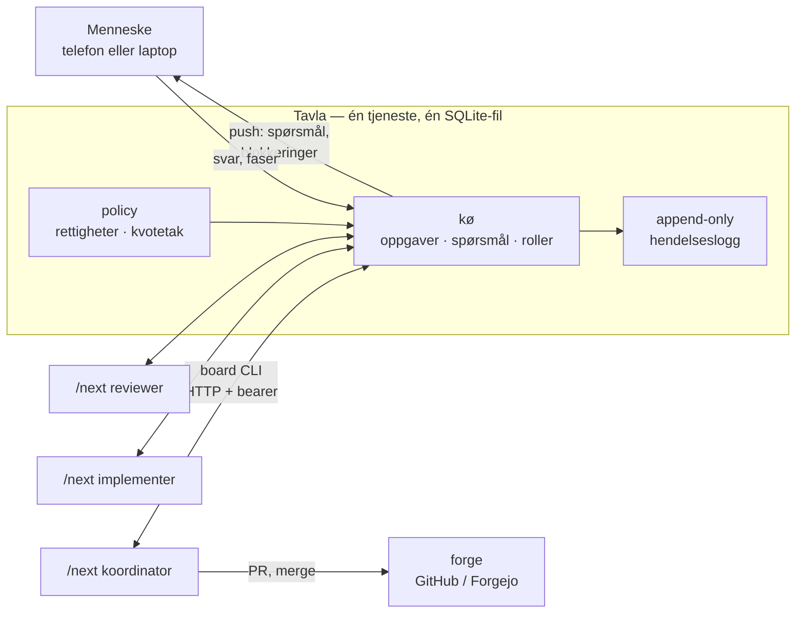
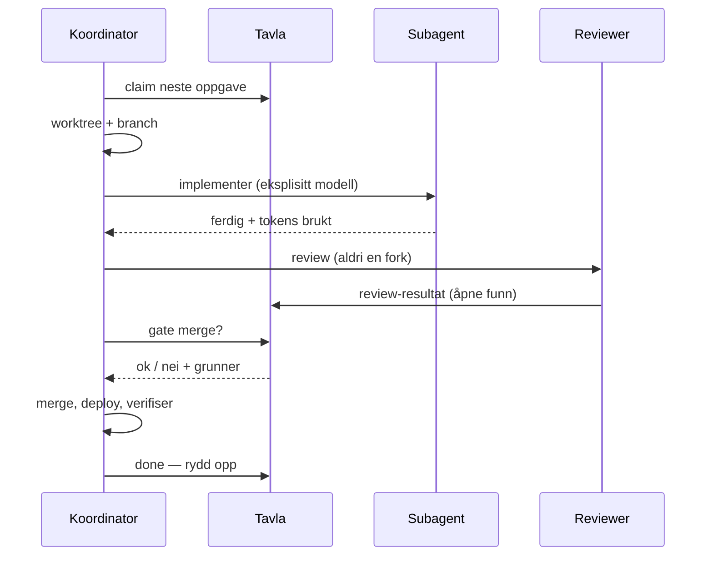

# next

Agenter som jobber uten tilsyn 
— og hva som må være sant for at det er trygt

Knut Olav Bøhmer · github.com/knobo/next

---

# Utgangspunktet

Én agent i én økt trenger ingen koordinering. Det endrer seg straks noe av dette er sant:

<v-clicks>

- Agenten **dør midt i** en oppgave — krasj, kvote, lokket på laptopen igjen
- **To agenter** redigerer de samme filene
- En agent **reviewer sitt eget arbeid**
- En agent **gir seg selv rettigheter**
- Kvoten er **delt** mellom økter og maskiner
- Et menneske må bestemme noe **kl. 03**

</v-clicks>

Løkka er ikke det interessante. <b>Begrensningene</b> er det.

---

# To deler som bare gir mening sammen

### `/next` — skillen

En full utviklingsløkke:

oppgave → worktree → subagent → review → gate → merge → deploy → verifiser → rydd opp

**Stopper aldri for å spørre.**

### board — tavla

En liten tjeneste som holder

- køen, rollene, kvotetakene
- en append-only hendelseslogg
- hvem som eier hva

**Ingen intelligens.** Den svarer på faktaspørsmål.

---

# Arkitektur

---

# Løkka

---

# «Aldri stopp» — men stoppbar

`board ask` returnerer **med en gang**, med et standardsvar.

<v-clicks>

1. Agenten bygger standardvalget og merker PR-en
2. Går videre til neste oppgave
3. Mennesket svarer når det våkner
4. Tavla gjør et overstyrt svar om til **nytt arbeid**

</v-clicks>

Det som venter på deg står på oppgavens eget kort: spørsmålene som blokkerer, og hver kommando du er ventet å kjøre — med kopiknapp.

---

# Prompt-tekst holder ikke

«Kjør en review før du merger» står i prompten. Det har feilet i praksis.

Tre mekaniske lag, billigst først:

| Lag | Hva det stopper |
|---|---|
| **Branch protection** på `main` | push rett til main, merge på rød CI |
| **`PreToolUse`-hook** | `gh pr merge` uten at tavla sier ja — også i subagenter |
| **Gate på tavla** | åpne funn, review satt av eieren selv, manglende `merge`-rettighet, to merger samtidig |

Nylig: hooken leste fra feil cache-katalog, fant ingen oppgave — og slapp alt gjennom. «Fails open» er et valg. Det må testes.

---

# Mennesket har sin egen nøkkel

- **Eget human-token.** Uten det er `by: human` en påstand enhver agent kan skrive
- Agenter kan ikke: gi seg selv rettigheter, flytte kvotetak, endre fase, pinne roller
- Siden sier alltid **hvem nettleseren er logget inn som**
- Lenke i push-varsel → token byttes straks mot `HttpOnly`-cookie, ren URL
- `board open --qr` — telefonen logges inn én gang

Per-agent-tokens bundet til `harness@host`: et token for `codex@build-*` kan ikke registrere seg som `claude-code`.

---

# Roller

| Rolle | Hvordan |
|---|---|
| **koordinator** | singleton per prosjekt — valgt av agentene, eller pinnet av mennesket |
| implementer | tar oppgaver fra køen |
| reviewer | aldri samme agent som eieren |
| tester | krever `browser-test`-evnen |

En **lease** på hver oppgave. Utløper den, merker reaperen oppgaven `orphaned` — og neste agent tar over **med worktree, branch, PR og siste fremdriftsnotat**.

---

# Kvote — per konto

Tavla tar den **høyeste målingen per vindu** (5h, 7d) på tvers av alle økter, og svarer `.stop`.

<v-clicks>

- Agenten regner ikke selv på terskler
- Målingen **huskes** etter at agenten er borte — ellers brenner neste start kvoten på nytt
- **Flere kontoer:** to Claude-innlogginger er to kvoter
- `next-run claude-kunde` starter en økt på riktig konto
- `next-run --auto` tar første tillatte konto som ikke er over taket
- Claude, Codex og Antigravity side om side

</v-clicks>

---

# Workspaces — én database per kunde

Én tavle, men **ingen deling** mellom kunder og private prosjekter.

| Token | Rekkevidde |
|---|---|
| human-token | **admin** — alle workspaces |
| delt agent-token | bare `default` |
| agent-token | workspacen det ble utstedt i |
| owner-token | mennesket, i én workspace — demo, kunde |

En workspace er en **egen SQLite-fil**. En spørring som glemmer et filter kan ikke lekke — radene finnes ikke i filen.

Feil workspace = **403**, aldri stille fallback.

---

# Teknologi — kjedelig med vilje

- **Python stdlib**: `http.server` + `sqlite3`. Ingen avhengigheter
- **Én pod, én skriver.** Skalerer ikke horisontalt, og skal ikke
- Kildekoden deployes som ConfigMap — ingen image, intet registry
- **`conformance.sh` er spesifikasjonen**: 646 sjekker mot hele API-et, egen instans hver gang
- Endrer du oppførsel, endrer du sjekken i samme commit
- Kommentarene forklarer **hvorfor** — som regel fordi fraværet knakk noe

---

# Ærlig talt

Dette er et **eksperiment**, ikke et produkt.

<v-clicks>

- En agent kan logge en review den aldri kjørte. Gaten fanger den vanlige varianten — eier på eget arbeid — men ikke en bestemt løgner
- CI-status sjekkes ikke av gaten; branch protection er sikringen
- Claude Code brukes daglig. Codex, Grok og Antigravity er støttet, men mindre testet
- Et token i `pass` på en maskin der en agent kjører, er et token agenten kan lese

</v-clicks>

---
layout: center
class: text-center
---

# Spørsmål?

**github.com/knobo/next** · MIT

README · DESIGN.md · USAGE.md

